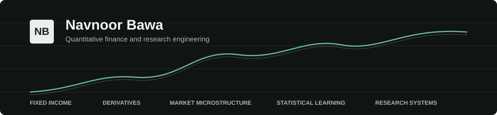

## Quantitative research and research engineering

I build empirical research systems for derivatives, volatility, fixed income, and statistical arbitrage. I care about the parts that determine whether a result survives contact with reality: point-in-time data, executable timestamps, transaction costs, leakage controls, multiple testing, reproducible metrics, and explicit negative results.

I am a Computer Science and Engineering undergraduate at Thapar Institute (2027), founder and quantitative researcher at Navnoor Bawa Research LLC, and a freelance markets analyst at [FX Empire](https://www.fxempire.com/author/navnoorbawa). Previously, I worked as a quantitative research intern at Quant Insider and as a WorldQuant BRAIN Research Consultant.

[LinkedIn](https://linkedin.com/in/navnoorbawa) &nbsp;|&nbsp; [Research writing](https://navnoorbawa.substack.com/) &nbsp;|&nbsp; [Medium](https://medium.com/@navnoorbawa) &nbsp;|&nbsp; [YouTube](https://youtube.com/@TheMathematicalTrader) &nbsp;|&nbsp; [X](https://x.com/navnoorquant)

### Selected work

| Project | What it demonstrates |
| --- | --- |
| **[Russell 3000 Statistical Arbitrage](https://github.com/NavnoorBawa/russell3000-pairs-trading)** | Point-in-time pair selection, Kalman spreads, regime gating, institutional cost profiles, 19 walk-forward windows, and statistical validation. The realistic t+1 result is disclosed as insignificant rather than presented as deployable alpha. |
| **[WTI Volatility Research](https://github.com/NavnoorBawa/WTI-Crude-Oil-Futures)** | A documented look-ahead failure, purge/embargo correction, negative-result retraction, and a separately validated HAR-IV volatility forecast. |
| **[U.S. Treasury Rates Monitor](https://github.com/NavnoorBawa/treasury-rates-monitor)** | Official Treasury CMT data, Federal Reserve H.15 history, curve analytics, ex-post regime classification, deterministic verification, and clearly separated delayed futures proxies. **[Live system](https://treasury-rates-monitor.vercel.app/)** |
| **[Options Pricing and Strategy Analyzer](https://github.com/NavnoorBawa/Option-Pricing-and-Strategy-Analyzer)** | Option pricing, Greeks, strategy P&amp;L, volatility surfaces, Monte Carlo simulation, and scenario analysis. |
| **[Interest-Rate Volatility Smile Engine](https://github.com/NavnoorBawa/Interest-Rate-Volatility-Smile-Engine)** | SABR calibration and the practical interpretation of alpha, beta, rho, skew, and model limitations in rate derivatives. |
| **[Trilemma Beta Bitcoin Tournament](https://github.com/NavnoorBawa/Bitcoin-Price-Prediction-Model)** | First place among 214 teams in the 2024 tournament. |

### Research principles

- Align every feature, label, and fill to information available at the decision timestamp.
- Recompute headline metrics from raw observations and retain the artifacts needed to reproduce them.
- Compare against simple baselines before attributing value to a complex model.
- Model costs, stale observations, missing data, publication lags, and non-trading days explicitly.
- Keep official observations, delayed market proxies, forecasts, and scenario outputs in separate datasets.
- Document failed hypotheses and retractions with the same precision as positive results.

### Toolkit

**Languages:** Python, C++, SQL, TypeScript 
**Research:** NumPy, pandas, SciPy, PyTorch, scikit-learn, XGBoost, QuantLib 
**Methods:** time-series analysis, statistical inference, walk-forward validation, factor models, volatility modeling, derivatives pricing, Monte Carlo simulation 
**Engineering:** React, Node.js, Linux, Git, CI, automated testing, financial data pipelines

Open to quantitative research, derivatives, fixed-income analytics, and research engineering opportunities.
